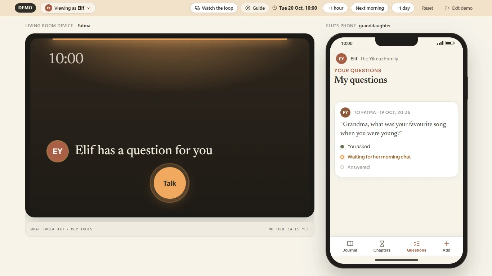
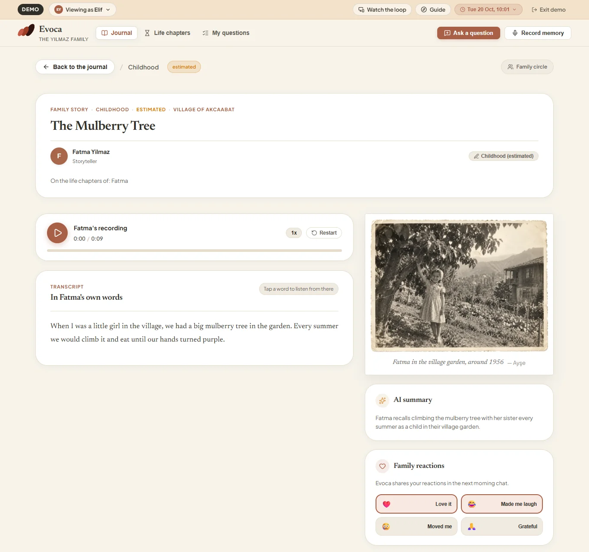
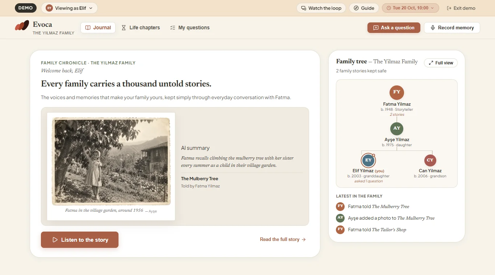
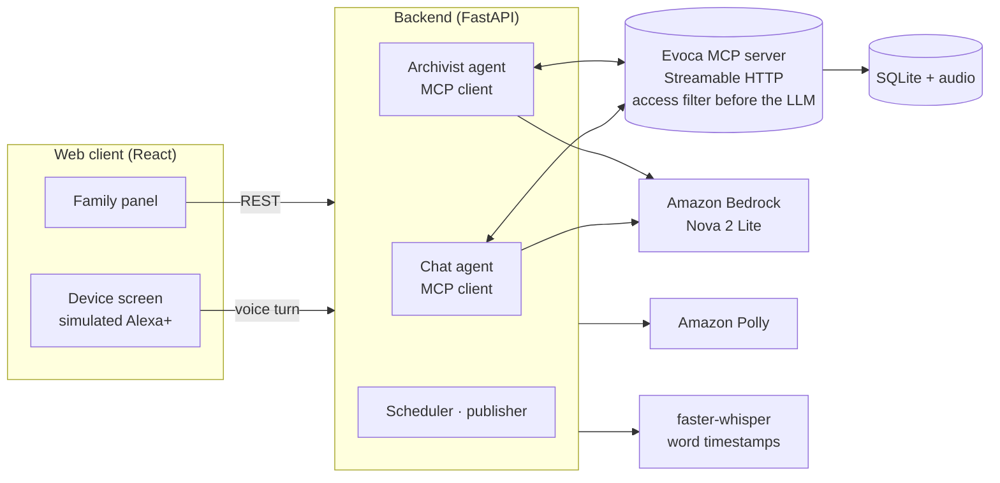

# Evoca

**A voice-first family memory. Grandma just talks; the whole family listens, asks and remembers with her.**

> Demo video (under 3 min): TODO link
> Track: Alexa+ (self-hosted MCP server + simulated device) · Mini challenge: AWS Builder · MIT licensed



---

## The problem

Every family loses its elders' stories. A story told on a phone call stays with the one person who heard it.
Existing products ask the elder to use a phone app and turn memories into a one-way book.
The moments when a family remembers *together* are never captured at all.

## What Evoca does

Evoca is an Alexa+-style companion for the elder and a web panel for the rest of the family.

| For the elder (voice only) | For the family (web panel) |
|---|---|
| A light comes on at chat time: "Elif has a question for you." | Ask a question; it reaches Grandma in a natural moment of conversation |
| A warm conversation with real follow-up questions | Hear **just the part of her story that answers you**, in her own voice, with "Maybe give her a call." |
| "Keep this between us" is honoured, always | Life chapters for every family member, with estimated periods the family can correct |
| "Play me what I told about the harbour" | Record your own memory; it appears on the chapters of everyone it is about |
| Hears the family's reactions: "Elif laughed at your story" | React with ❤️ 😂 😢 🙏, add an old photo, listen from the start |

It is a loop, not a one-way book: question → conversation → her voice → reaction → the next conversation.

**She does not have to be asked.** If Grandma tells the story behind a family question on her own, before the
companion ever asks it, Evoca recognises the answer and sends it to the person who asked.



**Any family can start.**

- **Setup wizard and personal links.** A setup wizard creates the family around one elder. Each person joins with
  their own invite link: no password, no app.
- **Members and admins.** Admins add and remove members, make links, and set the elder's chat time.
- **Sensitive topics.** Admins list subjects the companion must never raise. A question that touches one of these
  family topics is not sent, and the asker is told so. Only a topic Grandma refused herself is different: a
  question about it is held back but looks accepted to the asker, and that topic is never shown to anyone in
  the panel, not even admins.
- **My questions.** Each question shows its journey: asked, waiting for her morning chat, answered. When the answer
  is published, the asker gets a notification that opens it.
- **Life chapters for everyone.** Every family member has life chapters, not only the elder. A memory Elif records
  about her grandmother and herself shows on both their chapters.
- **Photos.** Anyone who can see a story can add its first photo. Replacing it is up to the teller, a person the
  story is about, or an admin.
- **Getting started.** A new family sees its first steps on the journal: connect the elder's device, invite the
  family, ask the first question.



## Who it is for, and why it matters

- **Elders who will never install an app**, but will talk to a voice at the kitchen table. Evoca asks nothing
  of them but conversation: no app, no login, no typing. She talks, and presses one button when she wants to.
- **Families spread across cities and countries**, who want to know the stories while there is still time to
  ask, and to hear them in her voice, not read a summary.
- **A reason to come back every day.** Each answer brings a reaction, each reaction brings the next conversation.
  The archive keeps growing instead of ending as a finished book.

## Built for Alexa+

Alexa+ talks to third-party services through MCP. Evoca is built the same way: the device only carries voice,
and everything Evoca knows and does sits behind its own MCP server. Alexa+ tools are not open to third parties
yet, so the device is simulated in the browser. Everything behind it is real and runs today: the MCP server,
both agents, speech-to-text, text-to-speech and the archive. Moving to a real Alexa+ device replaces the
simulated screen, not the system.

**Track path:**

- **A self-hosted MCP server** ([`mcp_server/server.py`](mcp_server/server.py)) over Streamable HTTP. It negotiates
  protocol version `2026-07-28`; the rules require `2025-11-25` or later. Checked with
  [`mcp_server/check_client.py`](mcp_server/check_client.py).
- **Used at runtime by both agents.** The chat agent and the archivist are MCP clients of that server; every
  conversation and every archiving run goes through its tools.
- **A simulated Alexa+ device** in the browser: the screen, the light, push-to-talk and the voice.

## How it works



**Two agents, one MCP server.** This mirrors how Alexa+ works with third-party MCP servers.

- **Chat agent** (during the conversation): reads the session context, weaves in waiting family questions,
  plays stories on request, and keeps private things private.
- **Archivist agent** (after the session): turns the transcript into stories with periods, matches answers to
  questions, merges a memory the model split in two, links related stories, finds gaps in the life timeline and
  asks about them later.
- **MCP server:** every tool filters by the viewer's access *before* anything reaches a model. Identity comes
  from request headers, never from tool arguments.

| MCP tool | Used by | What it does |
|---|---|---|
| `get_session_context` | Chat agent | Who she is, today's invitation reason, reactions to deliver, topics to avoid |
| `get_pending_questions` / `mark_question_asked` | Chat agent | Family questions, follow-ups and gap questions |
| `search_archive` / `get_linked_playlist` | Chat agent | Find and play earlier stories |
| `mark_private` | Chat agent's code | "Keep this between us" → audio, transcript and summary hidden |
| `get_session_transcript` / `save_story` | Archivist | Three-layer record: audio, word-timed transcript, summary |
| `record_answer` / `mark_question_declined` | Archivist | Match the answer's audio range to the question, verified by a checker model |
| `link_stories` / `find_gaps` / `add_question` | Archivist | Related stories, empty life periods, follow-up questions |
| `merge_stories` | Archivist's code | One memory the model saved in parts becomes one story again |
| `add_refused_topic` | Archivist | A topic she refuses is never raised again |
| `reopen_question` | Archivist's code | A question that was asked but not answered waits for the next conversation |
| `mark_reactions_delivered` / `set_story_access` | Chat agent and its code | Reactions are told once; she can choose by voice who hears a story |

All 18 tools of [`mcp_server/server.py`](mcp_server/server.py) are listed above; inputs and access rules per tool are
in [`docs/ARCHITECTURE.md`](docs/ARCHITECTURE.md). MCP Python SDK v2 (`mcp` 2.3), Streamable HTTP; client and server
negotiate protocol version `2026-07-28` (checked with [`mcp_server/check_client.py`](mcp_server/check_client.py)).

## Privacy by design

Families tell secrets. Evoca treats every privacy promise as something the code must keep, not the model.

- **Filter before the LLM.** One `can_see()` function guards every MCP tool and REST endpoint.
- **"Keep this between us"** marks the exact segments private; a fail-closed checker confirms promises the model
  makes, and a reply that promises privacy is never sent unless the marking happened.
- **Private means private.** Not even the center person hears another member's private recording.
  A hidden story's existence never leaks: same 404 as a missing one, no counts, no "1 item skipped".
- **Refusals are remembered, and never become stories.** A topic she declines is never raised again, a passage
  that is mainly a refusal is never saved as a story, and a question that touches a refused topic looks
  accepted to the asker.
- **24-hour pending window** before a story reaches the family; the teller, the subject, the center person or an
  admin can hide it.
- **Photos** are re-encoded with all metadata (GPS) stripped and served only through the access check.

**Evidence, not claims:**
- `tests/test_privacy_leak.py` captures every request sent to the LLM and asserts no private text is in it:
  `test_private_segment_from_prior_session_never_reaches_llm` (chat agent),
  `test_private_segments_never_reach_archivist_llm` (archivist, including the session being archived) and
  `test_text_marked_private_mid_session_never_reaches_llm_again` (a secret told live is gone from every later request).
- An end-to-end script (`scripts/e2e_demo.py`) runs the whole demo on real AWS and checks the secret appears nowhere.
- A `privacy-reviewer` Claude Code subagent (`.claude/agents/`) reviews feature branches before they merge.

## Quality evidence

| What | Result |
|---|---|
| Unit and API tests | 699 passed, 1 skipped in 110 s (`pytest`) |
| End-to-end demo on real AWS (`scripts/e2e_demo.py`) | 9/9 steps passed in 91 s: seed, admin settings, invitation, device session with a secret and a playlist, archivist, 24-hour publish, reaction, a family recording, next-day opening |
| Agent evals | 17 chat scenarios and 2 archivist scenarios, table below |

**How the agents are evaluated:** a model plays the elder in scripted scenarios (a secret, a refused topic, a
memory told in pieces), and every run is checked by code rules and a judge model: no private text repeated, no
invented facts, at most one question per reply, warmth.

Latest result per scenario ([`evals/run_evals.py`](evals/run_evals.py), [`evals/run_archivist_split.py`](evals/run_archivist_split.py);
judge: Claude Haiku 4.5 on Bedrock):

| Scenario | Runs | Rule checks | No invented facts | Model | Result |
|---|---|---|---|---|---|
| grandmother_basic | 3 | 87/87 | 3/3 | Nova 2 Lite | [prefetch_v1](evals/results/prefetch_v1.md) |
| asks_to_listen (playlist) | 3 | 72/72 | 2/3 | Nova 2 Lite | [playlist_fixed_x3](evals/results/playlist_fixed_x3.md) |
| declines_topic | 3 | 87/87 | 3/3 | Nova 2 Lite | [declines_v9](evals/results/declines_v9.md) |
| avoid_topic_not_raised | 3 | 90/90 | 3/3 | Nova 2 Lite | [prefetch_v1](evals/results/prefetch_v1.md) |
| private_then_move_on | 1 | 30/30 | 1/1 | Nova 2 Lite | [refused_v1_private](evals/results/refused_v1_private.md) |
| grandfather_no_questions | 3 | 78/78 | 3/3 | Nova 2 Lite | [prefetch_v1](evals/results/prefetch_v1.md) |
| short_answers | 1 | 28/28 | 1/1 | Nova 2 Lite | [full_v7](evals/results/full_v7.md) |
| grieving | 3 | 87/87 | 1/3 | Nova 2 Lite | [recheck_v1](evals/results/recheck_v1.md) |
| asks_the_companion | 1 | 29/29 | 1/1 | Nova 2 Lite | [full_v7](evals/results/full_v7.md) |
| topic_changer | 3 | 87/87 | 1/3 | Nova 2 Lite | [recheck_v1](evals/results/recheck_v1.md) |
| many_relatives | 3 | 90/90 | 3/3 | Nova 2 Lite | [recheck_v1](evals/results/recheck_v1.md) |
| answers_in_askers_voice | 3 | 88/90 | 2/3 | Nova 2 Lite | [askers_voice_baseline_v1](evals/results/askers_voice_baseline_v1.md) |
| hard_of_hearing | 1 | 29/29 | 1/1 | Nova 2 Lite | [full_v7](evals/results/full_v7.md) |
| agent_question_no_asker | 3 | 90/90 | 1/3 | Nova 2 Lite | [prefetch_v1](evals/results/prefetch_v1.md) |
| reaction_then_agent_question | 3 | 96/96 | 2/3 | Nova 2 Lite | [opening_attribution_after_x3](evals/results/opening_attribution_after_x3.md) |
| reaction_then_family_question | 3 | 96/96 | 2/3 | Nova 2 Lite | [opening_attribution_after_x3](evals/results/opening_attribution_after_x3.md) |
| reaction_and_family_question_same_person | 3 | 96/96 | 3/3 | Nova 2 Lite | [opening_attribution_after_x3](evals/results/opening_attribution_after_x3.md) |
| Archivist: one memory → one story | 3 | 3/3 correct | – | Nova 2 Lite | [split_v3](evals/results/split_v3.md) |
| Archivist: two memories → two stories | 3 | 3/3 correct | – | Nova 2 Lite | [split_v3](evals/results/split_v3.md) |

In `grieving` and `topic_changer` ([recheck_v1](evals/results/recheck_v1.md)), one run in six confused relations: the
elder answered her daughter's question in the daughter's voice ("your father" for her husband) and the companion
repeated it. The other findings were the judge counting the elder's own words as invented, plus one offer to play
stories that did not exist. A prompt rule for this case was tried and dropped: in `many_relatives` it made the
companion leave out the relation before family members' names in 2 of 3 runs
([relatives_regression_v1](evals/results/relatives_regression_v1.md),
[relatives_noise_v1](evals/results/relatives_noise_v1.md)). A scenario built for this case
(`answers_in_askers_voice`: she answers her granddaughter's question with "your grandfather was a tailor") shows the
companion repeating "your grandfather" to her in 2 of 3 runs, before she says his name. In `agent_question_no_asker` the invented fact is the same
judge finding with and without the opening prefetch (calling Zehra a childhood friend, which only the simulated elder
said): 2 of 3 runs with it, 1 of 3 without ([noprefetch_baseline_v1](evals/results/noprefetch_baseline_v1.md)).

**The opening is checked in code.** Who asked a question ("Your granddaughter Elif has a question for you") and how a
reaction is told ("loved", "laughed at", "was moved by", "was grateful for") are composed in code, and the reply is
checked afterwards. If the model drops the family lead-in or uses a reaction verb that does not match the emoji, a
template from the same data replaces the opening. In
[opening_attribution_after_x3](evals/results/opening_attribution_after_x3.md) the guard replaced the opening in 1 of
15 runs.

**Playlist checks.** Earlier playlist results were measured with a broken check: a stray backspace character where
`\b` belonged meant the "does not retell" and "unseen story" checks could never fail. `asks_to_listen` above is a
fresh run with the fixed checks. `get_linked_playlist` was called in all 3 runs. In the run the judge marked as
inventing facts, every detail it listed was said by the simulated elder, not the companion.

**Latency per voice turn** (measured on every turn and shown next to the device screen):

| Stage | Median |
|---|---|
| Speech-to-text | 3.5 s |
| LLM + MCP tools | 2.4 s |
| Text-to-speech | 0.26 s |
| Total | 6.3 s |

Median of the three voice turns in one earlier `scripts/e2e_demo.py` run (the latest run prints only per-turn
totals): Whisper small.en on a local CPU, Nova 2 Lite in us-east-1, Polly standard engine in eu-north-1.

Every turn also returns a **tool-call trace** (tool, input, short result, duration) shown beside the device.

## Built with

| | Used for |
|---|---|
| **Amazon Bedrock** (Nova 2 Lite, Converse API) | Both agents, privacy, answer and refusal checkers |
| **Amazon Polly** | The companion's voice, and Fatma's voice in the demo's sample answers |
| **Model Context Protocol** (Python SDK v2) | Evoca MCP server and the agents' MCP client |
| **Kiro** | Development environment and agent for the backend foundation; steering rules shared by every coding agent |
| **Claude Code** | Implementation and the `privacy-reviewer` subagent |
| faster-whisper | Local speech-to-text with word timestamps |
| FastAPI, SQLAlchemy, React + Vite | Backend and web client |

What worked and what did not, for each AWS service and tool: [`docs/friction-log.md`](docs/friction-log.md).

### How we used Kiro

- **Kiro IDE** was our development environment for the whole backend.
- **Kiro's agent built the foundation:** the data model and `can_see()` access control, the first MCP tools,
  the chat agent, and the FastAPI backend with the voice pipeline (Whisper → agent → Polly, with per-turn
  latency and a tool-call trace). For every task, Kiro first proposed a plan (files to change, open questions);
  we reviewed and corrected it, then it wrote the code and tests.
- **One rulebook for every agent.** `.kiro/steering/evoca-rules.md` holds the project rules: exact names from the
  data model, access filtering before the LLM, English everywhere. After AI-generated code used MCP SDK v1 APIs
  three times, we added an "MCP SDK v2" section to it, and the problem stopped. Claude Code reads the same file
  through `CLAUDE.md`, so both agents worked from one set of rules.
- When our free Kiro credits ran low, later features (archivist, panel, privacy hardening) were built with
  Claude Code under the same steering rules. See `docs/friction-log.md`.

## Run it locally

**Prerequisites:** Python 3.12+ (tested on 3.13), Node 20.19+ or 22.12+ (Vite 8), AWS credentials with Amazon
Bedrock access to Nova 2 Lite (us-east-1) and Amazon Polly (eu-north-1 by default, `POLLY_REGION`). No separate
ffmpeg install is needed.

```bash
git clone https://github.com/pnomokok/evoca && cd evoca
python -m venv .venv && source .venv/bin/activate   # Windows: .venv\Scripts\Activate.ps1
pip install -r requirements.txt
aws login                                            # or any standard AWS credential source; no secrets in the repo
python scripts/run_demo.py                           # seeds the demo family, starts MCP server (8000) and backend (8080)
cd web && npm install && npm run dev                 # second terminal: http://localhost:5173
```

To change defaults (Regions, voice, models), copy `.env.example` to `.env`; `run_demo.py` passes it to both servers.

The first start downloads the speech-to-text model (Whisper small.en, about 460 MB, into `data/hf-cache`) and can
take a few minutes.

On Windows, if activating the venv fails with "running scripts is disabled", run
`Set-ExecutionPolicy -Scope Process -ExecutionPolicy Bypass` first. The first start may print Hugging Face warnings
about symlinks and unauthenticated requests; they are harmless.

**The demo strip** (demo mode only) runs along the top of every demo page:

- **Person picker** ("Viewing as Elif"): open the archive as any family member.
- **Clock controls**: "+1 hour", "Next morning" (to the elder's chat time) and "+1 day" (past the 24-hour window).
- **Reset**: start the demo family over.
- **Guide**: start the guided tour.
- "Watch the loop" (the stage) and "Exit demo".

The same clock and reset are `POST /api/demo/advance` and `POST /api/demo/reset`.

**Whole demo without a browser:** `python scripts/e2e_demo.py`.

## Try it

The demo family is fictional. Its story photos and the landing page images are AI-generated with ChatGPT.

**Recommended: the guided tour.** Open http://localhost:5173, choose "Try the demo", then "Watch the loop"
(`/demo/loop`): Fatma's living room device and her granddaughter Elif's phone, side by side. The guide starts by
itself on the first visit ("Guide" in the demo strip starts it again) and walks through the whole loop in about
three minutes:

1. Elif asks Grandma a question on her phone.
2. "Next morning" moves the demo clock to chat time, and the device's light comes on.
3. Talk: Evoca brings up Elif's question; "Show MCP calls" in the demo strip shows the MCP tools it calls below the device.
4. Fatma answers, then says goodbye.
5. The archivist writes up the story and finds the part that answers Elif; "+1 day" passes the 24 hours the family
   has to hide it.
6. Elif hears the answer in Fatma's own voice and reacts.
7. The next morning, Fatma hears about the reaction.

Starting the guide starts the demo over. Each step moves on by itself when it happens, in any order; "Skip step" is there if you want to move on without doing it.

**No microphone needed.** When Evoca asks the tour's question, "Use a sample answer" on the device plays Fatma's
answer and sends that same audio exactly as a recording, so speech-to-text, the companion and the archivist all run
for real. The clips are Amazon Polly in Fatma's voice (`scripts/make_demo_audio.py`). Holding the microphone and
answering yourself always works too.

**On your own:** "Explore as a family member" (person picker) opens the archive as anyone in the family. As **Ayşe**
(admin), add a sensitive topic and see a question about it filtered. As **Fatma** on the device (with a microphone), try "keep this
between us" and "play me the story about the mulberry tree".

No account is needed: the demo entry is for judging only (see Known limits).

## Scope choices and known limits

What we chose not to build for the hackathon, and what we know is not solved yet. Each line: the limit, then what
we do about it or would do next.

- **Personal links are the only sign-in, and the demo has none.** Real families sign in with personal invite links:
  only token hashes are stored, and a new link revokes the old one. Whoever has a link is that person, so it should be
  shared privately. In demo mode the person picker can open the archive as anyone, by design, for judging; the
  `X-Person-Id`/`X-Circle-Id` headers are trusted only in demo mode.
- **Demo controls are open to everyone in demo mode.** Anyone on the page can move the clock or reset the demo, and
  moving past 24 hours shortens the time to hide a story; `EVOCA_DEMO_MODE` stays off outside the demo.
- **Uncommon names can be misheard.** Speech-to-text gets the family's names as hints, but a friend's or a place's
  unusual name can come out as another word, and the story then says what was heard (in testing, "Ayten" became
  "died"). In the 24 hours before a story reaches the family, the teller, a person it is about, the center person or
  an admin can hide it; the family can correct a story's life period, but not its words. Next: let the family fix a
  transcript word.
- **Refused topics are matched by words.** An indirect reference (asking about a sister after she refused to talk
  about her) is not caught; she can still decline, and next is semantic matching.
- **The privacy check is a model's judgment.** An indirect request ("leave this out of the family book") can be
  missed, and an explicit "keep this between us" can hide a harmless story too; we accept losing a story over
  leaking a secret.
- **Story boundaries are a judgement.** Code merges a memory the model split in two when the parts share a life
  period. A short, separate memory told right next to another one in the same period can be merged into it, and
  the archivist can leave a short sentence out of a story.
- **Hiding a story cannot be undone in the app.** An accidental hide is reversed only in the database; next: let the
  person who hid it undo it.

## Roadmap

- **Gathering mode:** at the holiday table, everyone's phone becomes a microphone; the family remembers together,
  and two versions of the same story are kept side by side.
- **More languages:** the data model already stores each person's language; multilingual speech-to-text and Polly
  voices would let a grandmother tell her stories in her own language.
- Real Alexa+ devices once third-party tools open.
- When an elder passes away, the circle becomes a memorial archive; what she kept private stays private forever.

## Team

- Zeynep Sude Kilecioğlu: backend, agents, MCP server and web integration
- Aleyna Karaağaç: web client, design and web integration

## License

MIT, see [`LICENSE`](LICENSE).
