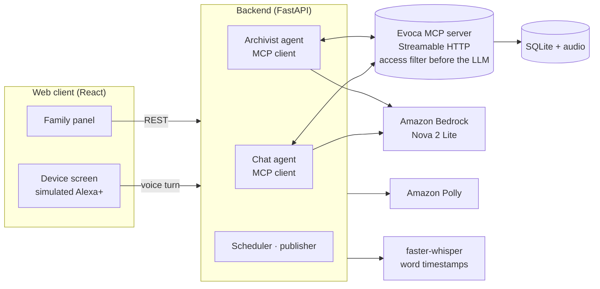

# Evoca

**A voice-first family memory. Grandma just talks; the whole family listens, asks and remembers with her.**

> Demo video (under 3 min): TODO link
> Track: Alexa+ (simulated device, real MCP server) · Mini challenges: AWS Builder, Open Source (MIT)

---

## The problem

Every family loses its elders' stories. A story told on a phone call stays with the one person who heard it.
Existing products ask the elder to use a phone app and turn memories into a one-way book.
The moments when a family remembers *together* are never captured at all.

## What Evoca does

Evoca is an Alexa+-style companion for the elder and a web panel for the rest of the family.

| For the elder (voice only) | For the family (web panel) |
|---|---|
| A light comes on at chat time: "Elif has a question for you." | Ask a question; it reaches Grandma in a natural moment of conversation |
| A warm conversation with real follow-up questions | Hear **just the part of her story that answers you**, in her own voice, with "Maybe give her a call." |
| "Keep this between us" is honoured, always | A life timeline that fills up, with estimated periods the family can correct |
| "Play me what I told about the harbour" | Record your own memory of her; it appears on the timeline of everyone it is about |
| Hears the family's reactions: "Elif laughed at your story" | React with ❤️ 😂 😢 🙏, add an old photo, listen from the start |

It is a loop, not a one-way book: question → conversation → her voice → reaction → the next conversation.

**She does not have to be asked.** If Grandma tells the story behind a family question on her own, before the
companion ever asks it, Evoca recognises the answer and sends it to the person who asked.

**Any family can start.** Set up a circle around one elder, add family members and admins, set sensitive topics
the companion must never raise, and follow the questions you asked.
TODO: confirm against the merged web client (circle setup wizard, member management, "My questions").

## Who it is for, and why it matters

- **Elders who will never install an app**, but will talk to a voice at the kitchen table. Evoca asks nothing
  of them except conversation: no screen, no login, no link to tap.
- **Families spread across cities and countries**, who want to know the stories while there is still time to
  ask, and to hear them in her voice, not read a summary.
- **A reason to come back every day.** Each answer brings a reaction, each reaction brings the next conversation.
  The archive keeps growing instead of ending as a finished book.

## Built for Alexa+

Alexa+ talks to third-party services through MCP. Evoca is built the same way: the device only carries voice,
and everything Evoca knows and does sits behind its own MCP server. Alexa+ tools are not open to third parties
yet, so the device is simulated in the browser. Everything behind it is real and runs today: the MCP server,
both agents, speech-to-text, text-to-speech and the archive. Moving to a real Alexa+ device replaces the
simulated screen, not the system.

## How it works



**Two agents, one MCP server.** This mirrors how Alexa+ works with third-party MCP servers.

- **Chat agent** (during the conversation): reads the session context, weaves in waiting family questions,
  plays stories on request, and keeps private things private.
- **Archivist agent** (after the session): turns the transcript into stories with periods, matches answers to
  questions, merges a memory the model split in two, links related stories, finds gaps in the life timeline and
  asks about them later.
- **MCP server:** every tool filters by the viewer's access *before* anything reaches a model. Identity comes
  from request headers, never from tool arguments.

| MCP tool | Used by | What it does |
|---|---|---|
| `get_session_context` | Chat agent | Who she is, today's invitation reason, reactions to deliver, topics to avoid |
| `get_pending_questions` / `mark_question_asked` | Chat agent | Family questions, follow-ups and gap questions |
| `search_archive` / `get_linked_playlist` | Chat agent | Find and play earlier stories |
| `mark_private` | Chat agent's code | "Keep this between us" → audio, transcript and summary hidden |
| `get_session_transcript` / `save_story` | Archivist | Three-layer record: audio, word-timed transcript, summary |
| `record_answer` / `mark_question_declined` | Archivist | Match the answer's audio range to the question, verified by a checker model |
| `link_stories` / `find_gaps` / `add_question` | Archivist | Related stories, empty life periods, follow-up questions |
| `merge_stories` | Archivist's code | One memory the model saved in parts becomes one story again |
| `add_refused_topic` | Archivist | A topic she refuses is never raised again |
| `reopen_question` | Archivist's code | A question that was asked but not answered waits for the next conversation |
| `mark_reactions_delivered` / `set_story_access` | Chat agent and its code | Reactions are told once; she can choose by voice who hears a story |

All 20 tools of [`mcp_server/server.py`](mcp_server/server.py) are listed above; inputs and access rules per tool are
in [`docs/ARCHITECTURE.md`](docs/ARCHITECTURE.md). MCP Python SDK v2 (`mcp` 2.3), Streamable HTTP; client and server
negotiate protocol version `2026-07-28` (checked with [`mcp_server/check_client.py`](mcp_server/check_client.py)).

## Privacy by design

Families tell secrets. Evoca treats every privacy promise as something the code must keep, not the model.

- **Filter before the LLM.** One `can_see()` function guards every MCP tool and REST endpoint.
- **"Keep this between us"** marks the exact segments private; a fail-closed checker confirms promises the model
  makes, and a reply that promises privacy is never sent unless the marking happened.
- **Private means private.** Not even the center person hears another member's private recording.
  A hidden story's existence never leaks: same 404 as a missing one, no counts, no "1 item skipped".
- **Refusals are remembered, and never become stories.** A topic she declines is never raised again, a passage
  that is mainly a refusal is never saved as a story, and a question that touches a refused topic looks
  accepted to the asker.
- **24-hour pending window** before a story reaches the family; the teller, the subject, the center person or an
  admin can hide it.
- **Photos** are re-encoded with all metadata (GPS) stripped and served only through the access check.

**Evidence, not claims:**
- `tests/test_privacy_leak.py` captures every request sent to the LLM and asserts no private text is in it:
  `test_private_segment_from_prior_session_never_reaches_llm` (chat agent),
  `test_private_segments_never_reach_archivist_llm` (archivist, including the session being archived) and
  `test_text_marked_private_mid_session_never_reaches_llm_again` (a secret told live is gone from every later request).
- An end-to-end script (`scripts/e2e_demo.py`) runs the whole demo on real AWS and checks the secret appears nowhere.
- A `privacy-reviewer` Claude Code subagent (`.claude/agents/`) reviews feature branches before they merge.

## Quality evidence

| What | Result |
|---|---|
| Unit and API tests | 598 passed, 1 skipped (`pytest`) |
| End-to-end demo on real AWS (`scripts/e2e_demo.py`) | 9/9 steps passed in 82 s: seed, admin settings, invitation, device session with a secret and a playlist, archivist, 24-hour publish, reaction, a family recording, next-day opening |
| Agent evals | 13 chat scenarios and 2 archivist scenarios, table below |

**How the agents are evaluated:** a model plays the elder in scripted scenarios (a secret, a refused topic, a
memory told in pieces), and every run is checked by code rules and a judge model: no private text repeated, no
invented facts, at most one question per reply, warmth.

Latest result per scenario ([`evals/run_evals.py`](evals/run_evals.py), [`evals/run_archivist_split.py`](evals/run_archivist_split.py);
judge: Claude Haiku 4.5 on Bedrock):

| Scenario | Runs | Rule checks | No invented facts | Model | Result |
|---|---|---|---|---|---|
| grandmother_basic | 1 | 29/29 | 1/1 | Nova 2 Lite | [polish_v1](evals/results/polish_v1.md) |
| asks_to_listen (playlist) | 1 | 24/24 | 1/1 | Nova 2 Lite | [polish_v1](evals/results/polish_v1.md) |
| declines_topic | 3 | 87/87 | 3/3 | Nova 2 Lite | [declines_v9](evals/results/declines_v9.md) |
| avoid_topic_not_raised | 3 | 90/90 | 3/3 | Nova 2 Lite | [refused_v1](evals/results/refused_v1.md) |
| private_then_move_on | 1 | 30/30 | 1/1 | Nova 2 Lite | [refused_v1_private](evals/results/refused_v1_private.md) |
| grandfather_no_questions | 3 | 78/78 | 3/3 | Nova 2 Lite | [recheck_v1](evals/results/recheck_v1.md) |
| short_answers | 1 | 28/28 | 1/1 | Nova 2 Lite | [full_v7](evals/results/full_v7.md) |
| grieving | 3 | 87/87 | 1/3 | Nova 2 Lite | [recheck_v1](evals/results/recheck_v1.md) |
| asks_the_companion | 1 | 29/29 | 1/1 | Nova 2 Lite | [full_v7](evals/results/full_v7.md) |
| topic_changer | 3 | 87/87 | 1/3 | Nova 2 Lite | [recheck_v1](evals/results/recheck_v1.md) |
| many_relatives | 3 | 90/90 | 3/3 | Nova 2 Lite | [recheck_v1](evals/results/recheck_v1.md) |
| hard_of_hearing | 1 | 29/29 | 1/1 | Nova 2 Lite | [full_v7](evals/results/full_v7.md) |
| agent_question_no_asker | 1 | 29/29 | 1/1 | Nova 2 Lite | [full_v7](evals/results/full_v7.md) |
| Archivist: one memory → one story | 3 | 3/3 correct | – | Nova 2 Lite | [split_v3](evals/results/split_v3.md) |
| Archivist: two memories → two stories | 3 | 3/3 correct | – | Nova 2 Lite | [split_v3](evals/results/split_v3.md) |

Invented facts still appear in 2 of 3 runs of `grieving` and `topic_changer` (for example, mixing up her husband
and her father); these are the two weakest scenarios.

**Latency per voice turn** (measured on every turn and shown next to the device screen):

| Stage | Median |
|---|---|
| Speech-to-text | 3.5 s |
| LLM + MCP tools | 2.4 s |
| Text-to-speech | 0.26 s |
| Total | 6.3 s |

Median of the three voice turns in one `scripts/e2e_demo.py` run: Whisper small.en on a local CPU, Nova 2 Lite in
us-east-1, Polly standard engine in eu-north-1.

Every turn also returns a **tool-call trace** (tool, input, short result, duration) shown beside the device.

## Built with

| | Used for |
|---|---|
| **Amazon Bedrock** (Nova 2 Lite, Converse API) | Both agents, privacy, answer and refusal checkers |
| **Amazon Polly** | The companion's voice |
| **Model Context Protocol** (Python SDK v2) | Evoca MCP server and the agents' MCP client |
| **Kiro** | Development environment and agent for the backend foundation; steering rules shared by every coding agent |
| **Claude Code** | Implementation and the `privacy-reviewer` subagent |
| faster-whisper | Local speech-to-text with word timestamps |
| FastAPI, SQLAlchemy, React + Vite | Backend and web client |

What worked and what did not, for each AWS service and tool: [`docs/friction-log.md`](docs/friction-log.md).

### How we used Kiro

- **Kiro IDE** was our development environment for the whole backend.
- **Kiro's agent built the foundation:** the data model and `can_see()` access control, the first MCP tools,
  the chat agent, and the FastAPI backend with the voice pipeline (Whisper → agent → Polly, with per-turn
  latency and a tool-call trace). For every task, Kiro first proposed a plan (files to change, open questions);
  we reviewed and corrected it, then it wrote the code and tests.
- **One rulebook for every agent.** `.kiro/steering/evoca-rules.md` holds the project rules: exact names from the
  data model, access filtering before the LLM, English everywhere. After AI-generated code used MCP SDK v1 APIs
  three times, we added an "MCP SDK v2" section to it, and the problem stopped. Claude Code reads the same file
  through `CLAUDE.md`, so both agents worked from one set of rules.
- When our free Kiro credits ran low, later features (archivist, panel, privacy hardening) were built with
  Claude Code under the same steering rules. See `docs/friction-log.md`.

## Run it locally

**Prerequisites:** Python 3.12+ (tested on 3.13), Node 20.19+ or 22.12+ (Vite 8), AWS credentials with Amazon
Bedrock access to Nova 2 Lite (us-east-1) and Amazon Polly (eu-north-1 by default, `POLLY_REGION`). No separate
ffmpeg install is needed.

```bash
git clone https://github.com/pnomokok/evoca && cd evoca
python -m venv .venv && source .venv/bin/activate   # Windows: .venv\Scripts\Activate.ps1
pip install -r requirements.txt
aws login                                            # or any standard AWS credential source; no secrets in the repo
python scripts/run_demo.py                           # seeds the demo family, starts MCP server (8000) and backend (8080)
cd web && npm install && npm run dev                 # second terminal: http://localhost:5173
```

To change defaults (Regions, voice, models), copy `.env.example` to `.env`; `run_demo.py` passes it to both servers.

The first start downloads the speech-to-text model (Whisper small.en, about 460 MB, into `data/hf-cache`) and can
take a few minutes.

**Demo controls** (demo mode only): move the clock forward to chat time or past the 24-hour window, and reset the
demo family, from the web client or `POST /api/demo/advance` and `POST /api/demo/reset`.
TODO: the web client buttons come with the unmerged web client; on `main` only the API exists.

**Whole demo without a browser:** `python scripts/e2e_demo.py`.

## Try it

TODO: rewrite after the web client's demo entry and guided tour are merged. Current flow:

1. As **Elif** (granddaughter), ask Grandma a question.
2. As **Ayşe** (admin), add a sensitive topic and see a question about it filtered.
3. Open the **device screen** as **Fatma**, press to talk, and answer. Try "keep this between us" and
   "play me the story about the mulberry tree".
4. Move the demo clock past 24 hours; as Elif, hear the answer in Fatma's voice and react.

No account is needed: the demo entry is for judging only (see Known limits).

## Scope choices and known limits

What we chose not to build for the hackathon, and what we know is not solved yet. Each line: the limit, then what
we do about it or would do next.

- **No sign-in.** The demo trusts the person and circle headers, so anyone with a circle's id can open the panel as
  any member; next: personal invite links or sign-in before any real family uses it.
- **Demo controls are open to everyone in demo mode.** Anyone on the page can move the clock or reset the demo, and
  moving past 24 hours shortens the time to hide a story; `EVOCA_DEMO_MODE` stays off outside the demo.
- **Refused topics are matched by words.** An indirect reference (asking about a sister after she refused to talk
  about her) is not caught; she can still decline, and next is semantic matching.
- **The privacy check is a model's judgment.** An indirect request ("leave this out of the family book") can be
  missed, and an explicit "keep this between us" can hide a harmless story too; we accept losing a story over
  leaking a secret.
- **The archivist sometimes splits one memory.** Code merges stories that overlap and share a life period; two short,
  separate memories told back to back in the same period can be merged by mistake.
- **Hiding a story cannot be undone in the app.** An accidental hide is reversed only in the database; next: let the
  person who hid it undo it.

## Roadmap

- **Gathering mode:** at the holiday table, everyone's phone becomes a microphone; the family remembers together,
  and two versions of the same story are kept side by side.
- **More languages:** the data model already stores each person's language; multilingual speech-to-text and Polly
  voices would let a grandmother tell her stories in her own language.
- Real Alexa+ devices once third-party tools open; personal invite links and sign-in.
- When an elder passes away, the circle becomes a memorial archive; private parts stay private forever.

## Team

- Zeynep Sude Kilecioğlu: backend, agents, MCP server
- Aleyna Karaağaç: web client and design

## License

MIT, see [`LICENSE`](LICENSE).
