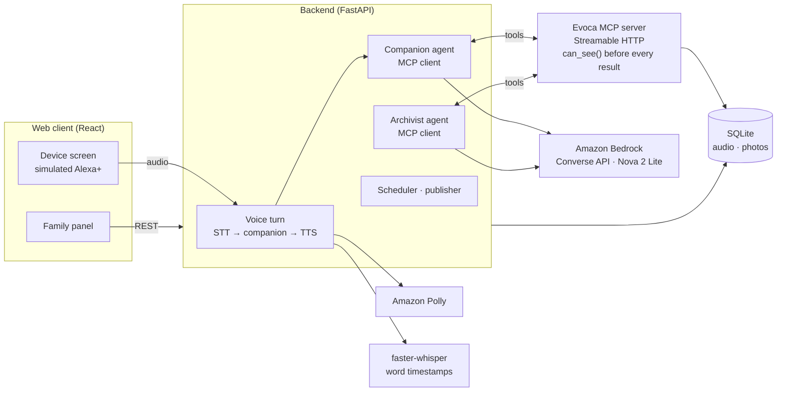
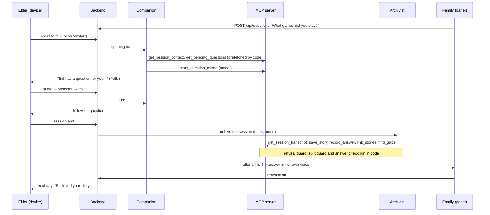

# Evoca architecture

Evoca is a voice companion for an elder and a web panel for her family. Two agents share one MCP server: a
**companion** that talks with the elder in real time, and an **archivist** that turns each conversation into stories,
answers and new questions. Every tool filters by the viewer's access **before** anything reaches a model, and the
privacy promises the companion makes are enforced in code.

This document explains how it works and is the single source of truth for the code: when a rule here and the code
disagree, one of them is a bug. For what Evoca is, how to run it and the quality evidence, see the
[README](../README.md). Sample API responses: [`docs/api-samples/`](api-samples/). Experiments:
[`spike-results.md`](spike-results.md). Problems we hit with tools and services: [`friction-log.md`](friction-log.md).

## Contents

1. [At a glance](#at-a-glance)
2. [Where it lives in the code](#where-it-lives-in-the-code)
3. [Key design decisions](#key-design-decisions)
4. [Privacy architecture](#privacy-architecture)
5. [System overview](#system-overview)
6. [Glossary](#glossary)
7. [User flows](#user-flows)
8. [Design principles and rules](#design-principles-and-rules)
9. [Data model](#data-model)
10. [Access control](#access-control)
11. [MCP tools](#mcp-tools)
12. [The archivist, step by step](#the-archivist-step-by-step)
13. [REST API](#rest-api)
14. [Background jobs and the demo clock](#background-jobs-and-the-demo-clock)
15. [How it is tested](#how-it-is-tested)
16. [Known limits](#known-limits)
17. [Out of scope, by choice](#out-of-scope-by-choice)

## At a glance



**One conversation, end to end**



## Where it lives in the code

| Part | Path | What to look at |
| --- | --- | --- |
| MCP server | [`mcp_server/server.py`](../mcp_server/server.py) | `MCPServer`, Streamable HTTP app, identity from headers (`get_viewer`), `ToolError` for messages the model can act on |
| MCP client | [`server/mcp_bridge.py`](../server/mcp_bridge.py) | `streamable_http_client`, identity headers set by the backend, never by the model |
| Companion | [`server/agents/chat_agent.py`](../server/agents/chat_agent.py), [`prompts/chat_agent.md`](../server/agents/prompts/chat_agent.md) | Tool loop, local tools (`keep_private`, `end_conversation`), reply guards, privacy checker |
| Archivist | [`server/agents/archivist_agent.py`](../server/agents/archivist_agent.py), [`prompts/archivist_agent.md`](../server/agents/prompts/archivist_agent.md) | Tool loop, refusal guard, split guard and merge, answer and decline checks |
| Amazon Bedrock | [`server/llm.py`](../server/llm.py) | `bedrock-runtime` Converse API with tool use |
| Speech | [`server/speech.py`](../server/speech.py) | `WhisperSTT` (word timestamps, name hints), `PollyTTS` |
| Voice turn | [`server/routers/device.py`](../server/routers/device.py) | Session start, turn, end; latency and tool trace per turn |
| Access control | [`core/access.py`](../core/access.py) | `can_see()` |
| Identity | [`server/auth.py`](../server/auth.py), [`core/services/auth.py`](../core/services/auth.py) | Bearer session or demo headers, invite links, token hashing |
| Business logic | [`core/services/`](../core/services/) | Shared by MCP tools and REST endpoints |
| Data model | [`core/models.py`](../core/models.py), [`core/enums.py`](../core/enums.py) | Exactly the names in [Data model](#data-model) |
| Web client | [`web/src/`](../web/src/) | `components/DeviceScreen.jsx` (device), `components/panel/` (family) |

## Key design decisions

| Decision | Why |
| --- | --- |
| **The companion is an MCP client; all business logic sits behind an MCP server.** | This is how Alexa+ works with third-party services. The simulated device can be replaced by a real one without touching the system. |
| **Two agents instead of one.** | The companion must answer in about a second and stay warm; the archivist can take its time after the session, read the whole transcript and make careful, checked decisions. Each gets only the tools it needs. |
| **Filter before the LLM, not after.** | A model cannot leak what it never saw. `can_see()` runs inside every tool; private segments never enter any prompt. |
| **Identity from connection headers, never from tool arguments.** | A model cannot be talked into acting as someone else. |
| **The model names intent; the code does the precise work.** | For "keep this between us" the model only picks a scope; the code computes exact segment boundaries. Millisecond ranges are never left to a model. |
| **The opening's attribution and reaction wording are composed in code and checked after the reply.** | `get_session_context` carries a ready `reaction_line` per story (❤️ loved, 😂 laughed at, 😢 was moved by, 🙏 was grateful for) and each waiting question a `lead_in` ("Your granddaughter Elif has a question for you:" or "I've been wondering about something:"). If the opening reply drops the family lead-in, gives a family question in its own voice (or its own to family), or uses a reaction verb that does not match the emoji, a template from the same data replaces it before TTS. |
| **Every risky model decision is checked by a second, temperature-0 call.** | Recording an answer, a decline, a refused topic, a privacy promise and "is this story really a refusal?" each get a one-word check; when unsure, the safe side wins. |
| **Three-layer record: audio, word-timed transcript, summary.** | The family hears her real voice, cut to exactly the part that answers them. The audio is never changed. |
| **24-hour pending window.** | The elder's family can hide a story before it reaches everyone, without an approval queue that would stop the loop. |
| **Local Whisper, cloud Bedrock and Polly.** | Word timestamps and family-name hints were essential; Transcribe was not available on our account plan. Model and engine are behind small interfaces. |

## Privacy architecture

Families tell secrets. Each layer below works on its own, so one failure does not leak.

| Risk | Defense | Where | Tested by |
| --- | --- | --- | --- |
| A model sees something private | `can_see()` and private-segment filtering inside every MCP tool, before results return | `core/access.py`, `core/services/` | `tests/test_privacy_leak.py` captures every LLM request |
| A model acts as another person | Identity from MCP connection headers set by the backend | `mcp_server/server.py` (`get_viewer`), `server/mcp_bridge.py` | `tests/test_session_tools.py` (`TestRequireMember`), `tests/test_circles.py` |
| "Keep this between us" is not honoured | Local `keep_private` tool; the code marks exact segments, also the companion's replies to them | `server/agents/chat_agent.py`, `mark_private` | `tests/test_chat_agent.py`, eval `private_then_move_on` |
| The secret comes back later in the conversation | Hidden turns are replaced in the agent's own history; their text is never sent to the LLM again | `chat_agent.py` | `tests/test_privacy_leak.py` |
| The companion promises privacy but nothing was marked | Final-reply check: a temperature-0 checker reads her words; "yes" or "unsure" marks them, "no" removes the promise | `chat_agent.py` | `tests/test_chat_agent.py` |
| The companion repeats a hidden name or detail | Salient words of hidden turns are kept in memory only; a reply that repeats one is regenerated, then replaced | `chat_agent.py` | `tests/test_chat_agent.py` |
| A failed mark | Fail closed: retried at session end; the archivist does not run while a mark is pending | `server/routers/device.py` | `tests/test_api.py` |
| A refusal is saved as a story | Refusal guard before `save_story`; when unsure, nothing is saved | `server/agents/archivist_agent.py` | `tests/test_archivist_real_session.py` |
| A refused topic is asked again, or revealed | Stored as a `speaker` topic; filtered from questions; never shown in any panel endpoint; the asker sees "accepted" | `core/services/` | `tests/test_refused_topics.py` |
| A hidden story's existence leaks | Same 404 as a missing story; no counts, no "skipped" markers | `core/services/stories.py` | `tests/test_panel_stories.py` |
| Location in old photos | Re-encoded, all metadata (EXIF, GPS) removed; served only through the access check | `core/services/photos.py` | `tests/test_photos.py` |

## System overview

The companion is an **MCP client** that runs inside the backend and reaches all business logic through Evoca's
MCP server. This is the same shape as Alexa+ with a third-party MCP server: the device carries voice; everything
Evoca knows and does sits behind the MCP server.

| # | Component | Role |
| --- | --- | --- |
| 1 | Web client: device screen | Simulates Alexa+ on an Echo Show. The elder talks here (press to talk). |
| 2 | Web client: family panel | Mobile-first. Questions, feed, story page, lifeline, recording, reactions, photos, admin settings. |
| 3 | Backend API (FastAPI, `server/`) | REST endpoints, device sessions, audio upload, the agent loop (LLM + MCP client), background jobs. |
| 4 | MCP server (`mcp_server/`) | Tools and the access filter. Streamable HTTP; negotiates protocol 2026-07-28 and still accepts clients on 2024-11-05 to 2025-11-25. |
| 5 | Core (`core/`) | Data model, `can_see()`, services, clock. Business logic lives in `core/services/`; both MCP tools and REST endpoints call it. |
| 6 | Speech | Speech-to-text with word timestamps (faster-whisper, local) and text-to-speech (Amazon Polly). |
| 7 | Data | SQLite and audio and photo files under `data/`. |

The web client talks only to the backend. Agents never touch the database directly; they reach data through MCP
tools that apply the access filter.

**Technology choices**

| Area | Choice | Why |
| --- | --- | --- |
| Backend and MCP | Python, FastAPI, MCP Python SDK v2 (`mcp` 2.3, `MCPServer`) | v2 implements protocol 2026-07-28 and still accepts clients on 2024-11-05 to 2025-11-25; verified on the first day. |
| LLM | Amazon Bedrock, Converse API, Amazon Nova 2 Lite for both agents and the checkers | Fastest of three models tested with tool calling (1.4 s). Region us-east-1, `us.` inference profiles. |
| Speech-to-text | faster-whisper `small.en` on CPU (int8), word timestamps, family names as hints | Word timestamps are required to cut answers. Without name hints names fail; with hints they are right. Faster models lost accuracy (see `spike-results.md`). Model set by `EVOCA_WHISPER_MODEL`. |
| Text-to-speech | Amazon Polly (standard engine, eu-north-1) behind one small interface | The account's project Region only offers the standard engine (see `friction-log.md`). Swapping the engine or Region does not touch the rest of the code. |
| Data | SQLite and local files | Enough for the hackathon. |
| Web client | React and Vite | Few dependencies. |
| Development | Kiro (IDE and agent, steering rules) and Claude Code under the same rules | See the README. |

**One voice turn on the device**

1. The elder presses the big button and speaks; the browser records.
2. The audio is uploaded, transcribed (with family names and the last question as hints) and stored as a `Segment`.
3. The companion answers using the session context and MCP tools. On the opening turn its code first calls
   `get_session_context` and `get_pending_questions` through MCP (`prefetch_context`), with the same identity and
   filtering, and gives the results to the model as its own tool results: one model round fewer. The model can
   still call both tools later.
4. The reply is cleaned (one question at most, no quotes, no asides), checked by the privacy guards, turned into
   speech and played; text and cards are shown on screen.
5. Every turn returns its latency (speech-to-text, LLM and tools, text-to-speech) and a trace of tool calls.
6. When the session ends, the archivist runs in the background (A6).

The privacy guards in a conversation are described in [Privacy architecture](#privacy-architecture).

## Glossary

Every concept has one meaning and one name in the code. Telling a story and being the center of a circle are
different things: anyone can tell a story, but a circle has one center person.

| Concept | Name in code | Meaning |
| --- | --- | --- |
| Person | `Person` | Anyone in the family. Everyone has their own lifeline. |
| Lifeline | `Lifeline` (computed, not stored) | The stories told **about** a person, grouped by life period. |
| Life period | `LifePeriod` | A period of life (childhood, youth, ...) used instead of exact years. |
| Family circle | `Circle` | The group around one center person. The seed has one demo circle (`is_demo`); `POST /api/circles` creates new ones. |
| Membership, role | `Membership.role` | A person's role in one circle: `center`, `admin` or `member`. Roles belong to the circle, not the person. |
| Center person | `role = center` | The elder of the circle. Has the device, gets invitations, questions go to them, the agent talks with them. |
| Session | `Session` | One conversation. Solo (elder and companion) or gathering (elder and family, roadmap). Same engine. |
| Segment | `Segment` | One person speaking without interruption in a session, with its audio range and transcript. |
| Story | `Story` | One memory. Based on one or more audio ranges. |
| Retelling | `Story.kind = retelling` | The same memory told at another time or by someone else. Linked to the original, never replaces it. |
| Subject | `StorySubject` | Whose life a story is about, each with their own period. The story appears on those people's lifelines. |
| Teller | `Story.teller_id` | Who told the story. Does **not** decide whose lifeline it appears on. |
| Link | `StoryLink` | A relation between two stories (same place, same event, continuation). Suggested by the agent; the family can remove it. |
| Question | `Question` | A question waiting to be asked of the center person. Source: family, follow-up or gap. |
| Gap | (computed) | A life period of the center person with no stories yet. |
| Invitation | `Invitation` | The device light at chat time. A reminder, never the only way to start a conversation. |
| Access | `Story.access` | Who can see a story: `circle`, `selected`, `private`, `all_family`. |
| Sensitive topic | `SensitiveTopic` | A topic never raised with the elder: set by an admin (`source = family`) or refused by the elder (`source = speaker`). |
| Reaction | `Reaction` | An emoji a family member leaves on a story. Told to the elder in words. |
| Photo | `StoryPhoto` | An old photo a family member adds to a story; one per story. The agents never see it. |
| Invite link | `InviteLink` | A person's personal link to one circle (`/join/<token>`); opening it signs them in. |
| Sign-in session | `AuthSession` | One signed-in browser or device, made from an invite link; sent as a bearer token. |
| Gathering mode | `Session.kind = gathering` | Roadmap: phones as microphones when the family is together. |

## User flows

The heart of the product is a loop: the family leaves a question, the elder tells a story, the answer goes back to
the person who asked in the elder's own voice, the family reacts and asks again.

**A1. The elder starts talking.** The elder presses the device button ("Alexa, something came to mind"). The
companion listens, asks follow-up questions when a story is short, and weaves in a waiting question at a natural
moment. When the session ends, segments are stored and the archivist turns them into stories (A6).

**A2. Invitation.** At chat time the device light comes on; the device never starts talking by itself. When the
elder presses the button, the companion gives the reason ("Elif has a question for you") and first passes on
waiting reactions ("Elif laughed at your umbrella story").

**A3. The question loop.**
1. A family member writes a question in the panel.
2. The question is checked against sensitive topics. If it matches, it is not queued and the asker gets a gentle
   message (but see the rule for topics the elder refused, below).
3. Waiting questions are ordered: family questions first, then follow-ups, then gap questions.
4. The companion asks it in its own words at a natural moment.
5. After the session, the archivist finds which audio range answers the question, using word timestamps.
6. That audio, its transcript and a labelled AI summary reach the asker, with "Maybe give her a call."

**A4. A family member's own memory.** Any member, the center person included, records a memory in the panel
(`POST /api/recordings`, at most 3 minutes, access `circle` or `private`). A one-person `panel_recording` session is
created; transcription and the archivist run in the background. The teller is always the person who recorded
(enforced in code); the subjects can be anyone in the circle ("My grandmother taught me to bake bread" → the center
person). A panel recording never produces answers, declines or questions.

**A5. Reactions and "Listen from the start".** Members react with ❤️ 😂 😢 🙏; no counts are shown, and reactions
are told to the elder at the next invitation. "Listen from the start" plays a story and its directly linked stories,
ordered by life period; stories the listener cannot see are skipped without a trace. The elder can ask the same by
voice ("Play me everything about the village house"): the companion finds the story with `search_archive`, calls
`get_linked_playlist`, introduces the list in one short sentence (titles and tellers only), and the device plays it.

**A6. After every session.**
1. The audio is stored and never changes.
2. The transcript is made with word timestamps.
3. The archivist extracts stories: title, summary, teller, subjects and their periods, place, a year only if said.
4. A range the elder asked to keep private is hidden in all three layers (audio, transcript, summary).
5. New stories wait 24 hours (`pending`), then open according to their access.

## Design principles and rules

These are enforced in code; demos and deadlines do not bypass them.

**Principles**

1. **The AI never imitates the elder.** It does not speak for her or clone her voice; it only finds and plays her
   real words.
2. **The recording is the source.** Transcript and summary are derived from it; if they disagree, the audio wins.
3. **Never rewrite, never invent.** No guessed years. Everything the AI produces is labelled "AI summary" or
   "estimated".
4. **The elder is in control.** She decides what is shared and can decline invitations.
5. **Not a monitoring tool.** No notifications to the family about health, mood or how often she talks.

**Invitations**

- At most one invitation per day per circle.
- If the elder already talked that day, the invitation is skipped.
- "Not today" is respected; declined invitations are never reported to the family.
- The reason is the most meaningful waiting thing: reactions first, then family questions, then the agent's questions.

**Access levels**

| Level | Code value | Who sees it | Status |
| --- | --- | --- | --- |
| This circle (default) | `circle` | Everyone in the story's circle | Built |
| Private | `private` | Only the teller | Built |
| Selected people | `selected` | People the teller chooses | Roadmap |
| All my family | `all_family` | All the teller's circles | Roadmap |

- The **teller** sets access. A subject can always narrow it (hide the story), never widen it.
- The center person chooses by voice: "Keep this between us" → private.
- Someone without access never learns that a private part **exists**. Only the teller sees "this story has a
  private part".
- **The filter runs before the LLM.** Every MCP tool filters by the viewer's access before returning anything to an
  agent, so the companion cannot say something private by accident.
- If an answer is marked so the asker cannot see it, the answer is not delivered.

**Publishing and privacy**

- A new story waits 24 hours as `pending`; the teller, a subject, the center person or an admin can hide it. Then it
  becomes `published` automatically.
- A range marked "keep this between us" is hidden in audio, transcript and summary together.
- Hiding is final through the API; an admin can hide a story but never edit it.

**Estimates and corrections**

- Periods and links are AI estimates and are shown as "estimated".
- The family corrects them in one tap. A family correction always wins and is never overwritten.
- The lifeline is not stored; it is computed from stories on every request.
- Different retellings of the same story are all kept, even if they disagree; the system does not decide which is
  true.

**Sensitive topics**

- An admin adds family topics (for example "the 1977 car accident").
- If the elder clearly refuses a topic on her own ("I don't want to talk about Hatice today"; not declining a
  question), the archivist stores it as a `speaker` topic (`add_refused_topic`). A refusal is permanent, even if she
  says "today". Topics the elder refused are **never returned by any panel endpoint, not even to admins**.
- A family question that only matches a topic the elder refused is stored as `filtered`, but the asker gets the
  normal accepted reply (`waiting`). A question matching a family topic gets the general "not sent" message. This
  way the elder's refusal, like a declined question, looks unanswered to everyone but the center person.
- The companion receives all topics as `avoid_topics` in `get_session_context`, without their source, and only when
  the viewer is the center person. It never raises them; if the elder brings one up, it listens warmly but asks
  nothing about it.
- Matching is by meaningful words (4+ letters, stop words removed) when a question is added and when the companion
  picks one. A filtered question is never deleted; it stays `filtered`.
- If the elder declines to answer a question, it becomes `declined` and is never asked again. The asker **never
  learns this**: to everyone except the center person, a declined question looks unanswered (`waiting` / `asked`).

## Data model

These types are the shared contract of the backend, the MCP server and the web client. Change a field or enum here
first. All ids are UUID strings, all times UTC ISO 8601 strings, audio ranges integer milliseconds.

**Enums**

```python
Role             = "center" | "admin" | "member"
CircleStatus     = "active" | "memorial"            # memorial: roadmap
LifePeriod       = "childhood" | "youth" | "marriage_early_years"
                 | "raising_children" | "midlife" | "retirement"
PeriodSource     = "ai" | "family"                  # family always wins
SessionKind      = "solo" | "gathering"
SessionStart     = "invitation" | "spontaneous" | "panel_recording"
StoryKind        = "original" | "retelling"
StoryStatus      = "pending" | "published" | "hidden"
AccessType       = "circle" | "private" | "selected" | "all_family"
LinkReason       = "same_place" | "same_event" | "continuation" | "answer_to"
LinkSource       = "ai" | "family"
LinkStatus       = "suggested" | "confirmed" | "removed"
QuestionSource   = "family" | "follow_up" | "gap"
QuestionStatus   = "waiting" | "asked" | "answered" | "filtered" | "declined"
                                                    # declined: the elder declined; never asked again
TopicSource      = "family" | "speaker"             # speaker: the elder refused it; never shown in the panel
InvitationStatus = "sent" | "accepted" | "postponed" | "declined" | "skipped"
Emoji            = "heart" | "laugh" | "sad" | "pray"
```

**Entities**

```python
Person:
  id, name, birth_year: int | None, language: "tr" | "en", created_at

Circle:
  id, name, center_person_id, status: CircleStatus,
  chat_time: "HH:MM", timezone: str,             # e.g. "Europe/Istanbul"
  is_demo: bool                                  # the seed's demo family; circles from POST /api/circles are false

Membership:                                       # PK (person_id, circle_id)
  person_id, circle_id, role: Role,
  relation_to_center: str | None                  # e.g. "daughter"; entered by an admin, never guessed by AI;
                                                  # empty for the center person

Session:
  id, circle_id, kind: SessionKind, started_by: SessionStart,
  participant_ids: [person_id], audio_path | None, started_at, ended_at | None

Segment:                                          # one person speaking without interruption
  id, session_id, speaker_id | None,              # None = the companion
  start_ms, end_ms, transcript,
  words: [{w, start_ms, end_ms}],
  is_private: bool

Story:
  id, circle_id, teller_id, kind: StoryKind,
  original_story_id | None,                       # set when kind = retelling
  title, ai_summary | None,                       # shown with an "AI summary" label
  sources: [{session_id, start_ms, end_ms}],      # audio ranges, never private ranges
  place | None,
  stated_year: int | None,                        # only if the teller said it
  access: {type: AccessType, person_ids: [id]},
  status: StoryStatus, publish_at,                # created_at + 24 hours
  created_at

StorySubject:                                     # PK (story_id, person_id)
  story_id, person_id, period: LifePeriod,
  period_source: PeriodSource, corrected_by | None

StoryPhoto:                                       # one per story; a new one replaces the old (file deleted)
  id, story_id, path,                             # data/photos/<uuid>.jpg, never a user-given name
  caption | None,                                 # at most 120 characters
  uploaded_by, created_at

StoryLink:
  id, from_story_id, to_story_id, reason: LinkReason,
  source: LinkSource, status: LinkStatus

Question:
  id, circle_id, target_person_id, asker_id | None,   # None = the agent
  text, source: QuestionSource, period: LifePeriod | None,
  status: QuestionStatus,      # waiting → asked (companion) → answered | declined
                               # | waiting again (archivist: asked but not answered)
                               # declined looks unanswered to everyone but the center person
  answer: {story_id, session_id, start_ms, end_ms} | None,
  created_at

SensitiveTopic:
  id, circle_id, text, source: TopicSource,       # default family
  added_by, created_at                            # for source = speaker, added_by = the center person

Reaction:                                         # PK (story_id, person_id, emoji)
  story_id, person_id, emoji: Emoji,
  delivered_to_center: bool, created_at

Invitation:                                       # unique (circle_id, date): one per circle per day
  id, circle_id, person_id, date: "YYYY-MM-DD",   # local day in the circle's time zone
  reason: str, status: InvitationStatus

InviteLink:                                       # at most one active (revoked_at = None) per (circle_id, person_id)
  id, circle_id, person_id,
  token_hash,                                     # SHA-256 hex of the token; the token itself is never stored
  created_by, created_at,                         # created_by = the admin (or the creator of a new circle)
  revoked_at | None                               # a new link for the same person revokes the old one

AuthSession:                                      # one signed-in browser or device
  id, person_id, circle_id,                       # the session fixes the circle
  token_hash,                                     # SHA-256 hex of the bearer token, never the token
  invite_id,                                      # the InviteLink it was made from
  created_at, revoked_at | None                   # revoked on logout, or when its invite link is revoked
```

Tokens (invite and session) are `secrets.token_urlsafe(32)`. Only their SHA-256 hashes are stored and looked up;
a token is returned once, when it is made, and never logged (the access log redacts `/api/invites/<token>`).

`Person.language` is stored but not used yet (every person is `en`); see the roadmap in the README.

**Computed views** (not stored)

- `lifeline(person_id, viewer_id)`: per period, the stories the viewer can see. A family correction wins over the AI
  period. Each period carries `years: {from, to}` from the person's `birth_year` with fixed age ranges (childhood
  0-12, youth 13-22, marriage_early_years 23-30, raising_children 31-45, midlife 46-60, retirement 61+); `to` is
  `null` for an open-ended period in the future, and `years` is `null` without a birth year.
- `gaps(person_id)`: the empty periods of the center person's lifeline.

## Access control

One function decides what a viewer can see; every MCP tool and every REST endpoint uses it.

```python
def can_see(viewer_id, story) -> bool:
    if story.status == "hidden" and viewer_id != story.teller_id: return False
    if story.status == "pending" and role(viewer_id) not in ("center", "admin") \
       and viewer_id != story.teller_id: return False
    t = story.access.type
    if t == "private":    return viewer_id == story.teller_id
    if t == "selected":   return viewer_id == story.teller_id or viewer_id in story.access.person_ids
    if t == "circle":     return is_member(viewer_id, story.circle_id)
    if t == "all_family": return shares_any_circle(viewer_id, story.teller_id)
    return False
```

Private segments (`is_private = true`) never enter a story's `sources`, any shared transcript or any LLM context.
A story the viewer cannot see returns the same 404 as a story that does not exist; there are no counts and no
"skipped" markers anywhere.

**Audio ranges (`GET /api/audio`).** The viewer must first be entitled to the range:
- the recorder of a `panel_recording` session, or the center person for a session she took part in, may hear any
  range of that session (the center has no whole-session right to another member's panel recording); or
- the range lies inside a source of a story the viewer can see; or
- the range lies inside the answer to the viewer's own question, and the viewer can see the answer's story.

A range that touches private segments is allowed only if the viewer is the speaker of every one of them; a private
companion segment has no speaker, so it is refused for everyone. Every refusal is the same 403, so a viewer cannot
tell a private part from audio they may not hear.

**Answer ranges.** The asker can hear the whole answer range, so `record_answer` and `mark_question_declined`
refuse a range that overlaps a private segment, and `merge_stories` widens an answer only across gaps that hold
nothing but the companion's turns; a private segment or any speech left out of the story stops it.

**Identity.** Every panel, admin, audio, photo and device endpoint resolves the viewer in one place
(`server/auth.py`):

1. `Authorization: Bearer <session_token>`: the token's hash must match an `AuthSession` that is not revoked. The
   session gives the person **and** the circle; an `X-Circle-Id` that differs from the session's circle gets the
   same 403 as a non-member. The person must still be a member of that circle, as before.
2. Without a bearer token, `X-Person-Id` and `X-Circle-Id` are accepted **only with `EVOCA_DEMO_MODE=1`**, and then
   behave exactly as in the hackathon build (the person picker of the web client).
3. Anything else is 401 with one body for every case (no header, a wrong, unknown or revoked token, `X-Person-Id`
   outside demo mode), so a caller cannot tell which tokens ever existed. One exception in demo mode: a request with
   no identity at all (no bearer token and no `X-Person-Id`) gets 403 "X-Person-Id header required"; a wrong,
   unknown or revoked token is still the same 401.

A session token comes from accepting an invite link (`POST /api/invites/{token}/accept`) or from creating a circle.
An admin makes a personal link for any member, the center person included; making a new one revokes the old. Revoking
a link (`DELETE /api/admin/invites/{person_id}`, a new link for the same person, or removing the member) also revokes
every session made from it. A link stays usable, for more devices, until it is revoked.

The MCP tools never take identity from the model's arguments. The backend opens each MCP connection with
`X-Evoca-Person-Id` and `X-Evoca-Circle-Id` (and `X-Evoca-Session-Id` for session tools) headers; the model only
gives content arguments. The MCP server trusts these headers, so it is internal: it must listen only where the
backend can reach it (127.0.0.1 or a private network), never be exposed to the internet.

## MCP tools

Three channels do the work: **MCP tools are called only by the agents**, **REST endpoints only by the web client**,
and **background jobs** run on a timer. Shared logic (adding a question, for example) lives in one service function
that both channels call.

| Tool | Called by | Input | Output | Notes |
| --- | --- | --- | --- | --- |
| `get_session_context` | Companion (prefetched by its code at the opening) | – | center person, invitation reason, undelivered reactions with `reaction_lines` (one ready sentence or two per story), summaries of the last 3 sessions, `avoid_topics` | At session start, called by the code before the first LLM call; this is the memory between sessions. `avoid_topics` is filled only when the viewer is the center person. |
| `get_pending_questions` | Companion (prefetched by its code at the opening), archivist's code | `limit?` (default 5) | ordered questions, each with its `lead_in` | Filtered for sensitive topics and access; family → follow-up → gap. |
| `mark_question_asked` | Companion | `question_id` | ok | When the companion asks it. |
| `add_question` | Archivist | `text, source: follow_up\|gap, period?` | `question_id` | Sensitive-topic check here too. A `gap` question needs a `period`; refused if one is already waiting for that period. |
| `search_archive` | Companion, archivist | `query, person_id?, period?` | stories (title, summary, audio range) | Keyword search, `can_see` filtered, at most 5, no transcripts. For the archivist, the code narrows it further: only published `circle` stories (or the teller's own pending ones) reach the model, without audio ranges, teller, access or status. |
| `get_linked_playlist` | Companion | `story_id` | one item per story: `story_id, title, teller, period`; no audio ranges | "Play me ..." by voice; depth 1, ordered by period, private parts cut, unseen linked stories leave no trace. The device rebuilds the audio ranges on the server with the same service. |
| `mark_private` | Companion's code (not the model) | `start_ms, end_ms`; session from header | ok | "Keep this between us". The model calls the local `keep_private(scope)`; the code computes exact segment boundaries. |
| `set_story_access` | Companion; archivist's code (a `private` panel recording) | `story_id, type` | ok | Access chosen by voice; teller only; `private` and `circle`. |
| `mark_reactions_delivered` | Companion's code | `story_ids` | ok | When a reply names everyone who reacted to that story; not told again next session. |
| `get_session_transcript` | Archivist | `session_id` | non-private segments with word times, asked questions | The archivist's input. The archivist's code adds `waiting_family_questions` (sensitive ones excluded) to what the model reads. |
| `save_story` | Archivist | `title, summary, teller_id, subjects: [{person_id, period}], sources, place?, stated_year?, original_story_id?` | `story_id` | `pending`, access `circle`. Every source must be from the session in the header; `original_story_id` must be visible to the viewer. |
| `record_answer` | Archivist | `question_id, story_id, start_ms, end_ms` | ok | The question becomes `answered` and the answer is delivered. The question must be `asked`, except a `waiting` family question the elder answered on her own; that one must target the center person and match no sensitive topic, otherwise the error is the same as for a missing question. The range must not overlap a private segment. A temperature-0 check confirms the words really answer it; if unsure, nothing is recorded. |
| `mark_question_declined` | Archivist | `question_id, session_id, start_ms, end_ms` | ok | Only if the elder clearly declined; confirmed by the same kind of check. The range must not overlap a private segment. |
| `add_refused_topic` | Archivist | `text, start_ms, end_ms`; session from header | `{topic_id, added}` | The elder refused a topic on her own. Only her own words in an archived, non-private range count; a temperature-0 check must say "yes". `text` names the topic itself ("Hatice", not "her sister Hatice"). Not offered for panel recordings. |
| `reopen_question` | Archivist's code | `question_id` | ok | An asked question that was neither answered nor declined goes back to `waiting`. |
| `merge_stories` | Archivist's code | `story_ids, title, summary`; session from header | `{story_id, merged_ids}` | Stories the split guard flagged that share a subject period become one: sources, subjects and links combined, a new title and summary from one LLM call over the merged non-private transcript; answers, photos, reactions and retellings move to the kept story; an answer range widens only across gaps holding nothing but companion turns (see [Access control](#access-control)). Only this session's `pending` stories, same teller. |
| `link_stories` | Archivist | `from_story_id, to_story_id, reason`; session from header | `{link_id, added}` | `ai` / `suggested`; `same_place`, `same_event`, `continuation`. Both stories visible to the viewer; `from` saved in this session; one link per pair in either direction; a link the family removed is never suggested again; at most 3 live links per story. |
| `find_gaps` | Archivist | `person_id` | empty periods | Center person only. Counts every non-hidden story about her, whatever its teller or access, but only period names leave the server. Periods she is too young for are not gaps. |

## The archivist, step by step

The **companion** talks with the elder live. The **archivist** runs in the background when a session closes. It
acts as the session's teller: the center person for a device session, the recorder for a panel recording, so its
tools only return what that person can see. Wherever a tool takes a session id (and in every `save_story` source),
the archivist's code replaces the model's value with the session being archived; the model never chooses which
session it reads.

1. Reads the session with `get_session_transcript`.
2. Extracts stories. For each, it first calls `search_archive` (place, person or object), then `save_story` (with
   `original_story_id` if it is a retelling). **One memory is one story**: a new detail, person or feeling about the
   same memory is not a new story; it only splits when she clearly moves to another event, time or place. Sources
   are only the teller's own segments, one source per segment.
   - **Split guard:** two stories from the same run whose sources overlap or are less than 5 seconds apart (the
     companion's turns do not count) and that share a place or a subject period are logged as a possible split,
     with ids only. After the run, those that share a subject period are merged with `merge_stories`.
   - **Refusal guard:** before `save_story` reaches the server, a temperature-0 check reads the teller's own words in
     the sources and answers whether the passage is mainly a refusal to talk about something. If "yes" or unsure
     (errors included), the story is not saved and the code runs the `add_refused_topic` path for that range.
     **A refusal never becomes a story.**
3. For every asked question, finds the answer range and calls `record_answer`. The transcript also lists waiting
   family questions (sensitive ones excluded); if the elder clearly answered one that was never asked, it is
   recorded the same way. A clear decline → `mark_question_declined`. A topic refused on her own →
   `add_refused_topic`.
4. Links stories that clearly share a named place, an event or a continuation with `link_stories`; if unsure, no link.
5. Calls `find_gaps` for the center person and adds at most one gap question per session, gentle and open
   ("What do you remember about your early married years?"); the period must be one `find_gaps` returned. At most
   two follow-up questions. Panel recordings get only `get_session_transcript`, `save_story`, `search_archive` and
   `link_stories`.
6. Every question still `asked` goes back to `waiting` with `reopen_question`, to be asked next time.

Delivering an answer is a side effect of `record_answer`; the agent never sends notifications itself.

## REST API

The web client calls these; all of them filter with `can_see`. Request and response samples:
[`docs/api-samples/`](api-samples/).

**Who is calling.** Every panel, admin, audio, photo and device endpoint needs `Authorization: Bearer
<session_token>`, or in demo mode `X-Person-Id` (Identity in [Access control](#access-control)); otherwise 401. In demo
mode, a request with no identity at all gets 403 "X-Person-Id header required".

**Choosing a circle (`X-Circle-Id`).** With a bearer token the session fixes the circle; an `X-Circle-Id` that differs
is the same 403 as a non-member. In demo mode without a bearer token, every such endpoint accepts an optional
`X-Circle-Id`. The viewer must be a member (on the device: the center person; for `/turn` and `/session/end`, the
session's circle), otherwise the same 403 as a non-member. Without it, the viewer's first membership is used.

| Endpoint | Used by | What it does |
| --- | --- | --- |
| `POST /api/device/session/start` | Device | Starts a session (`invitation` if one is active, else `spontaneous`), opens the MCP bridge and the companion, runs the opening turn; same shape as `/turn`. |
| `POST /api/device/turn` | Device | Uploads audio; returns the reply text, its audio, cards to show, latency and the tool trace. |
| `POST /api/device/session/end` | Device | Closes the session and starts the archivist. |
| `GET /api/device/invitation` | Device | Should the light be on? Also `now`, the demo-aware current time, for the device clock. |
| `POST /api/questions` | Panel | Adds a family question; a filtered question returns an explanation (see sensitive topics). A repeat of the same unanswered question returns the existing one, without revealing which state it is in; an unanswered question that matches a current family topic is never returned (whatever its status), so the repeat gets the "not sent" answer. |
| `GET /api/feed` | Panel | Answers and new stories. An answer card's audio is a list of the story's segments in that session, private segments cut and the companion's turns skipped. |
| `GET /api/lifeline/{person_id}` | Panel | The computed lifeline, every period in order (empty ones as empty lists); 404 if the person is not in the viewer's circle. |
| `GET /api/stories/{id}` | Panel | Story page: audio ranges, transcript, retellings, links, photo. Private parts are cut from audio, transcript and duration; `has_private_part` can be `true` only for the teller. Reactions without counts (`present`, `mine`). |
| `GET /api/stories/{id}/playlist` | Panel | "Listen from the start": the story and its direct links (depth 1, removed links excluded), by earliest subject period then creation time; unseen stories leave no trace. |
| `POST /api/recordings` | Panel | A member's own memory: multipart `audio` + `access?`; at most 3 minutes; returns 202 at once, processing in the background. |
| `POST /api/stories/{id}/reactions` | Panel | Adds or removes an emoji; idempotent; no counts returned. |
| `PATCH /api/stories/{id}/subjects/{person_id}` | Panel | Period correction (`period_source = family`); anyone who can see the story. |
| `PATCH /api/stories/{id}` | Teller, subject, center, admin | Only the teller changes access (`circle` / `private`). The teller, a subject, the center person or an admin can hide; hiding is final (`hidden: false` is refused for everyone). |
| `DELETE /api/links/{id}` | Panel | Removes a wrong link (`status = removed`); the viewer must see both stories. |
| `POST /api/stories/{id}/photo` | Teller, subject, admin | JPEG/PNG/WebP up to 5 MB, optional caption; re-encoded to a JPEG of at most 1600 px with all metadata (EXIF, GPS) removed. One per story. |
| `DELETE /api/stories/{id}/photo` | Uploader, teller, admin | Deletes the photo and its file. |
| `GET /api/photos/{photo_id}` | Anyone who can see the story | The JPEG, `Cache-Control: private, no-store`. A hidden story's photo is the same 404 for everyone, the teller included. |
| `GET`, `POST /api/admin/sensitive-topics`, `DELETE /api/admin/sensitive-topics/{id}` | Admin | Family topics only; topics the elder refused are never listed, counted or deletable (same 404 as a missing id). |
| `PATCH /api/admin/circle` | Admin | `chat_time`, `timezone`. |
| `POST`, `PATCH`, `DELETE /api/admin/members[/{person_id}]` | Admin | Add a member or admin; change relation or role; remove a membership. The center person's membership never changes; the last admin cannot be removed or demoted. |
| `GET /api/audio/{session_id}?start=&end=` | Anyone with access | Streams an audio range; the rules are in [Access control](#access-control). |
| `GET /api/tts/{file}` | Device | A generated reply audio file, only for the participants of its session. |
| `GET /api/people?circle_id=` | Person picker | Demo mode only (otherwise 404). The people of one circle (`id, name, role, relation_to_center, birth_year`); no story data. |
| `GET /api/circles/demo` | Person picker | Demo mode only (otherwise 404). The demo circle's `{id, name}`. |
| `POST /api/circles` | New family | No auth. Creates a circle, its center person and the creator as admin; also the creator's invite link and a sign-in session (`session_token`, `invite_url_path`). |
| `POST /api/admin/invites` | Admin | `{person_id}` of any member, the center included: makes their personal link and revokes the old one (and its sessions). Returns `{invite_url_path: "/join/<token>", token, person_id}`; the token is shown only here. |
| `DELETE /api/admin/invites/{person_id}` | Admin | Revokes the person's active link and every session made from it; 404 if there is none. |
| `GET /api/invites/{token}` | Join page | No auth. `{circle_name, person_name, role}` for an active link; the same 404 for a revoked, wrong or unknown token. |
| `POST /api/invites/{token}/accept` | Join page | No auth. Makes a sign-in session: `{session_token, person_id, circle_id}`. The link stays usable until revoked; same 404 as above. |
| `POST /api/auth/logout` | Panel, device | Revokes the current session (bearer only; 401 otherwise). |
| `GET /api/circle` | Panel | The circle, "me" and members; for an admin each member also has `has_invite` (an active personal link exists). |
| `GET /api/questions/mine` | Panel | The viewer's own questions, only `waiting` or `answered`: declined questions and questions on a topic the elder refused look `waiting`. `answered` only once the viewer can see the answer's story. An unanswered question that matches a current family topic is not listed, whatever its status. |
| `GET /api/demo/clock`, `POST /api/demo/advance`, `POST /api/demo/reset` | Demo controls | Only with `EVOCA_DEMO_MODE=1` (otherwise 404). `advance {hours}` (1-72) moves the demo clock and runs the publisher and invitation scheduler at once. `reset` rebuilds the database from the seed, and only if it is `data/demo.db`. |

## Background jobs and the demo clock

- **Invitation scheduler** (every minute and at startup; `core/services/invitations.py`): for each active circle,
  once chat time has passed in the circle's time zone and there is no invitation for that local day, it creates one
  for the center person. If she already started a session that day, or one is live, the invitation is `skipped`.
  The reason is made in code, in this order: reactions to her stories ("Elif reacted to your story"), a waiting
  family question ("Elif has a question for you"), a waiting follow-up or gap question ("I have a question about one
  of your stories"), otherwise "Would you like to chat today?". Only questions `get_pending_questions` would offer
  count (waiting, matching no sensitive topic). A reason never contains question text, a story title or a topic
  word; at most one first name.
- **Publisher** (every minute): makes `pending` stories past `publish_at` `published`.
- **Gaps:** not a separate job; the archivist checks after every device session.

**Demo clock.** `now_utc()` is (`DEMO_NOW` or the real time) plus a demo offset. The offset exists only with
`EVOCA_DEMO_MODE=1`, moves forward with `POST /api/demo/advance`, and is stored in the database so the API and the
MCP server, two processes, see the same time. Code never calls `datetime.now()` directly.

## How it is tested

| Layer | What | Where |
| --- | --- | --- |
| Unit and API | Services, MCP tools, REST endpoints, access rules, agents with fake LLMs | `tests/` (`pytest`) |
| Privacy | Every request sent to the LLM is captured; no private text may appear | `tests/test_privacy_leak.py` |
| Agents | A model plays the elder in scripted scenarios; code rules and a judge model check every run (no private text repeated, no invented facts, one question per reply, warmth) | `evals/`, results in `evals/results/` |
| End to end | The whole demo story through the real REST API, on real AWS, with real speech | `scripts/e2e_demo.py` |
| Reviews | A `privacy-reviewer` subagent checks feature branches against these rules | `.claude/agents/privacy-reviewer.md` |

Current numbers are in the README.

## Known limits

What we know is not solved, and what limits the damage.

- **Demo mode trusts headers, by decision.** With `EVOCA_DEMO_MODE=1`, `X-Person-Id` and `X-Circle-Id` are
  trusted and the person picker lets anyone open the panel as anyone, the center person included; a circle id works
  like an unlisted link. The web client still uses this path. Outside demo mode only personal invite links work.
- **An invite link is the whole credential.** Whoever has the link (or a session token) is that person until an
  admin revokes it; there is no password, expiry or second factor. An admin can make a link for anyone in the
  circle, the center person included, and so act as them. `POST /api/circles` is open to anyone.
- **The MCP server trusts its identity headers.** It is internal and must never be reachable from outside.
- **Demo controls are open in demo mode.** Anyone on the page can move the clock or reset the demo database, and
  `advance` shortens the 24-hour window. Real use runs without `EVOCA_DEMO_MODE`.
- **The privacy checker is an LLM judgement.** It may say "no" to an indirect request ("keep it out of the family
  book"), and then no automatic mark is made. This is deliberate, so that refusing a topic is not treated as a
  secret. An explicit `keep_private` always marks, so a misread can also hide a harmless story.
- **Refused topics are matched by words.** An indirect reference ("What was Zehra like?" after refusing Hatice) is
  not caught; the elder can still decline the question.
- **The companion can take on the asker's point of view.** When the elder answered her daughter's question in the
  daughter's voice ("your father" for her husband), the companion repeated it (1 of 6 eval runs). In a scenario built
  for this case ("your grandfather was a tailor") it repeated "your grandfather" to her in 2 of 3 runs, until she said
  his name. A prompt rule for this was tried and dropped, because it made the companion leave out relations before
  family members' names. It also sometimes offers to play stories that do not exist.
- **Story boundaries are a judgement.** A short separate memory told right next to another one in the same period
  can be merged into it, and the archivist can leave a short sentence out of a story.

<details>
<summary>Smaller limits</summary>

- If a segment is marked private after its story was saved, audio and transcript are cut on every read, but the
  title and summary are not regenerated. In the current flow, marks happen before the archivist runs.
- A private panel recording is saved as `circle` and set to `private` milliseconds later; in that window, the center
  person or an admin could see the pending story.
- Words of a hidden turn that name another person also become guard words, so mentioning that person later may
  change the subject.
- Both servers must run in demo mode for the demo clock (`scripts/run_demo.py` does this); the code does not check.
- Hiding cannot be undone through the API.
- Deleting a family topic does not re-check questions it filtered.
- Removing a member only removes the membership; their stories and waiting questions stay.
- The last-admin check is not locked against two simultaneous requests.
- A photo's size limit relies on `Content-Length`; a chunked upload is checked only after reading. In production
  the reverse proxy should also enforce it.
- A person in two circles signed in to one of them can still open a story, photo or link of the other circle by id
  when `can_see` allows it (they are a member there too); circle-scoped endpoints and audio stay in the session's
  circle.
- Revoking a link or logging out does not end a device session that is already live.
- Declined and postponed invitations are not tracked separately; a started session marks the invitation `accepted`.

</details>

## Out of scope, by choice

| Idea | Why not |
| --- | --- |
| Fire TV app | A second platform that adds nothing to the loop. |
| Animated or generated video | Expensive, and invented images break the "never invent" principle. |
| A printed memory book | The core of existing products; Evoca is a living conversation, not a book. |
| AI-hosted podcasts | Overlaps with Alexa's own features. |
| Detecting contradictions and asking the elder | Heavy, and the system does not judge which retelling is true. |
| Exact year guesses | Error-prone; life periods instead. |
| Voice cloning, emotion analysis | Ethical problems and unreliable. |
| Automatic family trees, gamification | Error risk; cheapens family relationships. |
| Health or mood monitoring | Would turn the product into a monitoring tool. |
| Public sharing | A family product; needless privacy risk. |
| A detailed approval queue | Stops the loop; the 24-hour window instead. |
